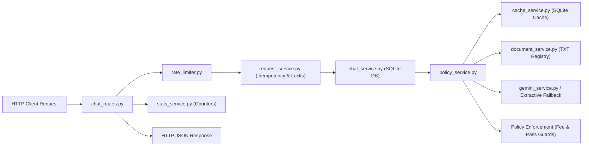

# Module 11 Implementation Plan: Integration, Testing & Error Handling (Final Refinement)

## 1. Overview & Objective

Module 11 unifies, validates, and stress-tests all previously developed and approved modules (Modules 1 through 10) into an end-to-end integrated application.

The primary objective of Module 11 is to prove that the entire helpdesk chatbot system operates reliably across all architectural tiers without regressions:
1. **Full-Stack HTTP Integration**: End-to-end traversal from client request through rate limiting, idempotency coordination, conversation history, policy retrieval, caching, Gemini synthesis / extractive fallback, to database persistence and operational statistics.
2. **Acceptance-Test Verification**: Systematic verification of the 12 canonical student queries from Section 17 of the architecture specification, enforcing topic-level authority routing, document supersession, and honest refusal behavior.
3. **Resilience & Fault Tolerance**: Deterministic fallback behavior when Gemini is unconfigured or unavailable, SQLite transaction rollbacks, rate limiting, and thundering-herd deduplication.
4. **Offline Determinism**: Automated regression testing that is 100% decoupled from external network access, API keys, or live cloud dependencies.
5. **Regression Safety**: Preserving all 335 existing passing tests without modifications, deletions, or weakened assertions.

---

## 2. Reconciled Endpoint Classification

To ensure architectural precision, all application endpoints are strictly categorized into their appropriate functional tiers:

### A. Mandatory Assignment-Required Endpoints
These endpoints directly fulfill the core functional specification of the student helpdesk chatbot:
- `POST /api/v1/conversations`: Create a new conversation session, generating a validated UUID identifier (HTTP 201).
- `GET /api/v1/conversations/<id>/messages`: Retrieve the chronological message history for an active conversation (HTTP 200).
- `POST /api/v1/conversations/<id>/messages`: Submit a student question, executing the full processing pipeline (rate limit, idempotency lock, context resolution, document retrieval, policy enforcement, Gemini synthesis / extractive fallback, persistence, stats counter) and returning an authoritative grounded answer (HTTP 200).
- `GET /api/stats`: Retrieve public operational counters (`total_requests`, `cache_hits`, `gemini_calls`, `errors`, `uptime_seconds`, `worker_note`) from in-process memory without consuming AI quota (HTTP 200).

### B. Supporting & Lifecycle Endpoints
These endpoints were implemented in Modules 6, 7, and 10 to support complete browser UI capabilities and maintenance hygiene:
- `GET /api/v1/conversations`: List existing conversations sorted by `updated_at DESC` for the frontend conversation sidebar.
- `GET /api/v1/conversations/<id>`: Retrieve conversation metadata.
- `DELETE /api/v1/conversations/<id>`: Hard-delete a conversation with SQLite cascading deletion of associated messages.
- `GET /api/v1/cache/stats`: Operational inspection of cache entries, size, and hit rates.
- `POST /api/v1/cache/cleanup`: Maintenance endpoint to prune expired cache records.

### C. Root Page & Health Endpoints
- `GET /`: Serves the static HTML5 single-page application (`index.html`) from the `frontend/` directory with public cache headers.
- `GET /health`: Liveness probe returning HTTP 200 `{"status": "healthy"}`, strictly decoupled from the Gemini API and external dependencies.

---

## 3. Course Documents & Cache Fingerprinting Architecture

### A. Official Documents Format
The official course knowledge base consists exclusively of four plain-text files located in `data/documents/`:
1. `01_course_handbook.txt` (**Doc 01**): Course overview, weekly syllabus schedule, learning objectives, faculty contacts, and certificate fee (₹1,500).
2. `02_grading_policy_v1.txt` (**Doc 02**): Historical grading policy (superseded by Doc 03 for grading and submission rules; excluded from retrieval).
3. `03_grading_policy_v2.txt` (**Doc 03**): Updated grading criteria, assessment weighting, 60% overall passing threshold, separate 40% final exam minimum, 85% distinction threshold, assignment/quiz submission deadlines, and late-submission penalties.
4. `04_exam_rules_and_faq.txt` (**Doc 04**): §1 & §2 are authoritative for final exam rules (Nov 20, 2026, 90 mins, AI-proctored, laptop/desktop only); §3+ contains unmoderated student forum excerpts (strictly excluded from retrieval).

### B. Document Fingerprint Implementation & Q12 Procedure
In [`backend/services/cache_service.py`](file:///C:/Users/ACHYUTHA/OneDrive/Desktop/API%20M%26H%20Dashboard/dpm101-chatbot/backend/services/cache_service.py#L184-L225), `CacheService.compute_documents_fingerprint()` computes a composite SHA-256 hash across all registered text files:
1. It inspects each document file's nanosecond modification timestamp (`st_mtime_ns`) and byte size (`st_size`).
2. When cached mtimes match the filesystem, it returns the cached fingerprint instantly (microsecond latency).
3. When any document file's content or mtime changes, it reads the file bytes, computes `hashlib.sha256(content).hexdigest()`, and combines all document hashes into a master document fingerprint.
4. The composite cache key is generated via:
   $$\text{SHA-256}(\text{normalized\_query} \parallel \text{doc\_fingerprint} \parallel \text{policy\_version} \parallel \text{model\_version})$$
5. **Exact Q12 Test Procedure**:
   - In an isolated test environment with temporary document files, query Q9 (*"What is the late submission penalty?"*) is asked and cached under composite key $K_1$ containing document fingerprint $FP_1$.
   - A subsequent repeat of Q9 verifies a Cache HIT on $K_1$.
   - The test modifies the content of `03_grading_policy_v2.txt` in the isolated temporary documents directory.
   - Calling `compute_documents_fingerprint()` recalculates fingerprint $FP_2 \ne FP_1$.
   - Querying Q9 again generates composite key $K_2 \ne K_1$.
   - The cache lookup for $K_2$ produces a **Cache MISS**, verifying that the old cached answer $K_1$ is not reused and fresh evaluation is executed against the updated text.

---

## 4. Exact Section 17 Acceptance-Test Questions & Expected Outcomes

The 12 acceptance test questions from Section 17 of `implementation_plan.md` are mapped to their exact approved Module 7 cache behaviors:

| # | Sample Question | Expected Behaviour | Authority Source | Implemented Cache Behaviour |
|---|---|---|---|---|
| **1** | *"What are the passing requirements for DPM-101?"* | Answer minimum score to pass (at least 60% overall AND at least 40% in Proctored Final Exam separately) and distinction threshold (85% or above), as stated in Doc 03. | Doc 03 (`03_grading_policy_v2.txt`) | Standalone query $\rightarrow$ Cached under exact composite key after first successful turn |
| **2** | *"When is the capstone project deadline?"* | Answer capstone/assignment submission deadline from Doc 03. | Doc 03 (`03_grading_policy_v2.txt`) | Standalone query $\rightarrow$ Cached under exact composite key |
| **3** | *"When is the final exam and what are the rules?"* | Answer exam date (Nov 20 2026), duration (90 min), closed-book, AI-proctored, desktop/laptop + webcam + microphone required, no phones/tablets. Source: Doc 04 §1–§2 only. Doc 03 must not appear as source. | Doc 04 §1–§2 (`04_exam_rules_and_faq.txt`) | Standalone query $\rightarrow$ Cached under exact composite key |
| **4** | *"What is the certificate fee?"* | Answer certificate fee amount as stated in Doc 01 (₹1,500). Forum fee (₹4,999) rejected. | Doc 01 (`01_course_handbook.txt`) | Standalone query $\rightarrow$ Cached under exact composite key |
| **5** | *"What is the refund policy?"* | No official document covers a refund policy. Chatbot must state clearly that this information is not available in official documents and advise contacting course support. Must not invent an answer or cite forum comments. Honest decline (`is_supported: false`). | No document $\rightarrow$ Honest decline | **Never Cached**: Unsupported topic (`is_supported: false`) is strictly excluded from cache storage |
| **6** | *"How does the best-five-of-six quiz rule work?"* | Explain quiz scoring rule (best 5 scores counted from 6 quizzes) as stated in Doc 03. | Doc 03 (`03_grading_policy_v2.txt`) | Standalone query $\rightarrow$ Cached under exact composite key |
| **7** | *"Can you help me with SQL joins / Kubernetes setup?"* | Outside DPM-101 course scope. Chatbot must decline and explain it only answers DPM-101 questions using official documents. Polite decline (`is_in_scope: false`). | Out of scope $\rightarrow$ Polite decline | **Never Cached**: Out-of-scope query (`is_in_scope: false`) is strictly excluded from cache storage |
| **8** | *"Who won the cricket World Cup?"* | Completely unrelated to course. Chatbot must decline and redirect student to helpdesk topic. Polite decline (`is_in_scope: false`). | Unrelated $\rightarrow$ Polite decline | **Never Cached**: Unrelated query (`is_in_scope: false`) is strictly excluded from cache storage |
| **9** | *"What is the late submission penalty?"* followed by *"What if I miss it by just one day?"* | First question answered from Doc 03, cached as standalone. Second question: follow-up classifier detects implicit reference to penalty just discussed. Passes multi-turn conversation history. | Doc 03 (`03_grading_policy_v2.txt`) | First question: Cached as standalone. Second question: **Cache Bypassed** (context-dependent query neither reads nor writes cache) |
| **10** | *"What is the late submission penalty?"* (exact repeat, same or new session) | Exact composite-key match. Returns cached answer (`is_duplicate: false`, cache counter increments, Gemini calls unchanged). | Doc 03 (`03_grading_policy_v2.txt`) | **Cache HIT**: Exact composite key match (`cache_hits` increments) |
| **11** | *"What happens if I submit my assignment late?"* (rephrased question) | Wording differs from Q9. Generates different SHA-256 composite key. Fresh evaluation performed. | Doc 03 (`03_grading_policy_v2.txt`) | **Cache MISS**: Wording difference results in different composite key; evaluates freshly |
| **12** | *"What is the late submission penalty?"* after Doc 03 text is updated | When Doc 03 text changes in temporary documents directory, recalculated document fingerprint produces different composite key. Old cached answer under previous fingerprint is not reused. Fresh evaluation against updated chunks. | Updated Doc 03 (`03_grading_policy_v2.txt`) | **Cache MISS**: Document fingerprint change invalidates old composite key; fresh evaluation |

---

## 5. Non-Redundant Integration Scope & Test Strategy

To prevent unnecessary duplication with the 335 existing unit and frontend tests, Module 11 focuses strictly on **multi-tier integration seams and cross-service coordination**:

### Gap Analysis: What Existing Tests Cover vs. What Module 11 Adds

| Component Seam | Covered in Existing Tests (Modules 1–10) | Module 11 Cross-Tier Integration Gap Addressed |
|---|---|---|
| **API Endpoints** | Unit tests mock backend services; frontend tests check static HTML/CSS/JS. | **True full-stack execution**: HTTP request passing through actual Flask client into real SQLite database, rate limiter, request manager, and policy pipeline simultaneously. |
| **Section 17 Questions** | Policy service tested with direct python method calls (`policy_service.ask()`). | **End-to-end HTTP validation**: Submitting Section 17 questions through `POST /api/v1/conversations/<id>/messages` and asserting JSON response structures, HTTP headers, DB persistence, and cache transitions. |
| **Multi-Turn Context** | Chat service context resolution tested in isolation. | **Sequential HTTP turns**: Sending Turn 1 via HTTP $\rightarrow$ persisting to SQLite $\rightarrow$ sending Turn 2 follow-up via HTTP $\rightarrow$ verifying prompt context reconstruction and cache bypass. |
| **Cache Invalidation** | Cache key generation tested with mock hashes. | **Filesystem-driven invalidation**: Modifying an actual course `.txt` file on disk $\rightarrow$ recalculating fingerprint $\rightarrow$ querying via HTTP $\rightarrow$ verifying cache miss and updated fingerprint evaluation. |
| **Fault Recovery** | Mocked exception tests for isolated components. | **End-to-end degradation**: Simulating Gemini network failure during an active HTTP request and confirming the client receives an HTTP 200 grounded extractive fallback with source attribution, while operational error counters increment accurately. |

### Deterministic Test Execution Principles
1. **100% Offline by Default**: The automated test suite uses controlled mocks for `GeminiService` and the built-in deterministic Extractive Fallback engine. It never makes live network calls to Google Gemini, avoiding flaky tests, rate-limit blocks, or credential dependencies.
2. **Optional Live Gemini Probe**: Delineated into a separate optional verification script (e.g. `tests/probe_live_gemini.py`) that executes only when `GEMINI_API_KEY` is explicitly configured in the shell environment.
3. **No Arbitrary Test Count Targets**: Focus on high-value, comprehensive scenarios rather than padding test counts. All 335 baseline tests are preserved.

---

## 6. Detailed Integration Test Scenarios (`tests/test_module11_e2e_integration.py`)

The new test suite will implement focused cross-tier integration scenarios structured into 5 core classes:

### Suite 1: Full-Stack Multi-Turn Conversation Lifecycle (`TestE2EConversationLifecycle`)
- **E2E-01**: Complete conversation round-trip: `POST /api/v1/conversations` creates session $\rightarrow$ `POST .../messages` persists user & assistant turns in SQLite $\rightarrow$ `GET .../messages` returns sorted history with citations $\rightarrow$ `DELETE` cascades deletion $\rightarrow$ Subsequent access yields HTTP 404.
- **E2E-02**: Multi-turn contextual follow-up: Turn 1 sets context (*"What is the late submission penalty?"*) $\rightarrow$ Turn 2 resolves implicit reference (*"What if I miss it by just one day?"*) $\rightarrow$ verifies prior turn injected into prompt and cache lookup is bypassed.

### Suite 2: Section 17 Canonical Questions End-to-End (`TestE2ESection17Acceptance`)
- **E2E-03**: Questions 1, 2, 6 (Grading, Capstone, Quizzes) $\rightarrow$ Verifies Doc 03 is cited, Doc 02 is absent, 60% overall passing threshold and 40% final exam minimum are enforced, and distinction requires 85% or above.
- **E2E-04**: Question 3 (Final Exam logistics) $\rightarrow$ Verifies Doc 04 §1–§2 is cited, exam date is Nov 20, 2026, and forum comments are excluded.
- **E2E-05**: Question 4 (Certificate fee) $\rightarrow$ Verifies Doc 01 is cited and fee is ₹1,500 (adversarial ₹4,999 forum claim rejected).
- **E2E-06**: Questions 5, 7, 8 (Refund, Kubernetes, Cricket World Cup) $\rightarrow$ Verifies polite decline responses with `is_supported: false` or `is_in_scope: false` and confirms **they are never stored in cache**.
- **E2E-07**: Question 11 (Rephrased question) $\rightarrow$ Verifies different wording generates a different composite key, producing an expected **Cache MISS** and fresh evaluation without semantic matching.

### Suite 3: End-to-End Cache Lifecycle & TXT Fingerprint Invalidation (`TestE2ECacheAndFingerprinting`)
- **E2E-08**: Cold-start cache miss $\rightarrow$ stores validated answer $\rightarrow$ Question 10 exact repeat yields cache HIT (`cache_hits` counter increments; Gemini call count unchanged).
- **E2E-09**: Question 12 document update invalidation: Modifying `03_grading_policy_v2.txt` content and recalculating `compute_documents_fingerprint()` produces a new fingerprint $\rightarrow$ repeated question causes cache MISS and evaluates fresh content. Old cache entry under previous fingerprint is not reused.
- **E2E-10**: Unsupported answers (refund decline), out-of-scope answers, and error responses are verified absent from cache table.

### Suite 4: Cross-Tier Concurrency, Idempotency & Rate Limiting (`TestE2EConcurrencyAndLimits`)
- **E2E-11**: Thundering herd duplicate resolution: 3 concurrent identical POST requests $\rightarrow$ Primary executes synthesis, duplicate threads wait on condition variable $\rightarrow$ all 3 receive identical HTTP 200 payload without duplicate DB inserts or multiple Gemini calls.
- **E2E-12**: Sliding window rate limiting: Burst of 20 requests succeeds $\rightarrow$ 21st request receives HTTP 429 with valid `Retry-After` header $\rightarrow$ replaying an existing completed request during rate-limited cooldown succeeds without consuming quota.
- **E2E-13**: Same-conversation lock contention: Concurrent differing queries to the same conversation return HTTP 409 `CONVERSATION_BUSY` when lock times out.

### Suite 5: Error Injection, Extractive Fallback & Metrics Integrity (`TestE2EFaultToleranceAndStats`)
- **E2E-14**: Extractive fallback on provider outage: Simulating Gemini network/auth failure during message POST $\rightarrow$ server does not crash or return 500; returns HTTP 200 with policy-grounded fallback extracted from course text files, citing official sources.
- **E2E-15**: Statistics accuracy across the pipeline: Verifies that valid requests, cache hits, fallback errors, and Gemini calls accurately increment the 6 fields on `GET /api/stats` without double-counting.
- **E2E-16**: Health check decoupling: Repeated calls to `GET /health` return HTTP 200 without altering `gemini_calls` or operational stats.

---

## 7. Files Expected to Change

| File | Nature of Change | Justification |
|---|---|---|
| `tests/test_module11_e2e_integration.py` | **Create** | New end-to-end integration test suite implementing the 16 focused cross-tier scenarios. |
| `README.md` | **Modify** | Update with Module 11 documentation, integration test execution guide, and final testing status. |
| `module11_implementation_plan.md` | **Update** | Refined architecture and implementation plan (Phase 1). |
| `module11_implementation_report.md` | **Create (Phase 2)** | Evidence collection and execution report generated after implementation. |
| `backend/**` / `frontend/**` | **Zero Changes Anticipated** | Existing production code is verified by 335 passing tests. Changes will occur only if an authentic cross-tier defect is found. |

---

## 8. Final Verification Criteria

Module 11 will be complete and eligible for approval when:
1. `tests/test_module11_e2e_integration.py` is implemented and passes all 16 cross-tier scenarios.
2. All 12 acceptance questions from Section 17 are verified through the HTTP API with their exact approved cache behaviors.
3. Cache invalidation is proven via actual course `.txt` file fingerprint recalculation without server restarts.
4. The test suite executes 100% deterministically offline without network or API key dependencies.
5. All 335 baseline tests across Modules 1–10 continue to pass with zero regressions.
6. Zero changes are made to production backend or frontend code unless resolving a verified defect.
