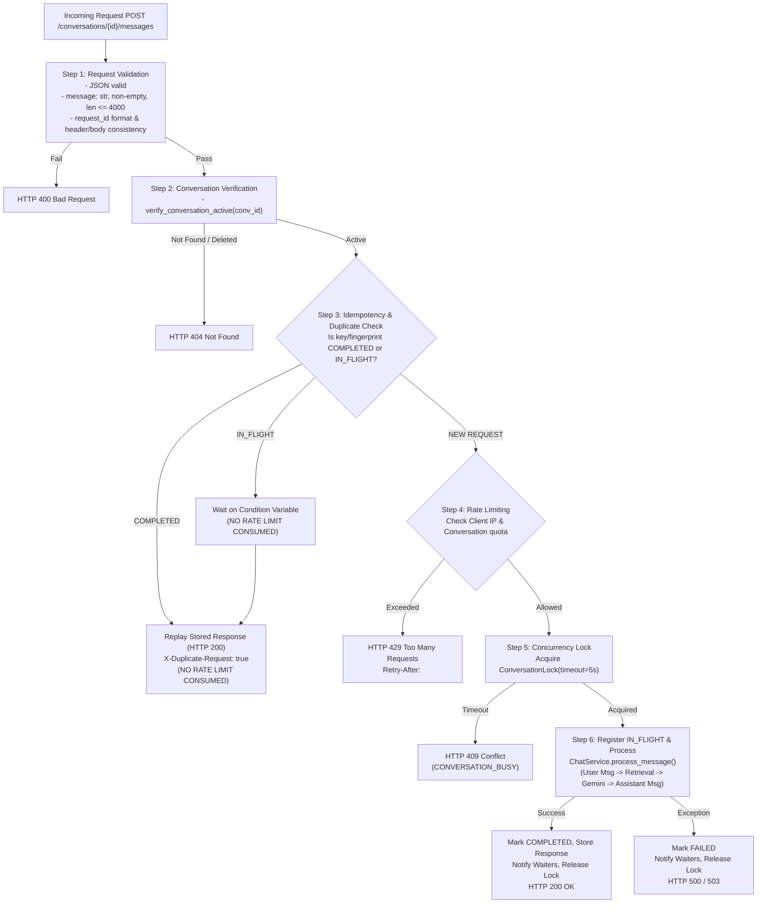

# MODULE 8 — REQUEST MANAGEMENT & DUPLICATE PREVENTION
## Final Technical Implementation Plan & Architectural Validation (Phase 1B)

**Project:** IIMBx DPM-101 Course Helpdesk Chatbot  
**Module:** 8 of 12  
**Status:** Phase 1B — Final Plan Validation ONLY (No Implementation Code)  
**Date:** November 11, 2026  
**Baseline Test Suite:** 265 / 265 Passed (100%)  

---

## 1. Original Requirements Traceability

The table below maps every original Module 8 requirement and specification clause from the project roadmap (Architecture Plan Section 15, Section 9, Section 11, and Section 12) directly to its planned implementation and verifiable acceptance tests.

| Original Requirement ID & Source | Requirement Statement | Planned Implementation | Acceptance Test in `test_request_management.py` | Status |
|---|---|---|---|---|
| **REQ-8.1**<br>*(Arch §5, §11.3)* | **Strict Input Validation**<br>Validate JSON, string type, non-empty content, length bounded ($\le 4000$ chars), and session/conversation existence. | `chat_routes.py` input validation block: type checking, whitespace stripping, length clamp, UUID validation, and idempotency key syntax check. | `test_request_validation_type_and_length`<br>`test_request_id_format_validation`<br>`test_mismatched_request_id_header_body` | **Mapped (100%)** |
| **REQ-8.2**<br>*(Arch §15 Roadmap)* | **Rapid Double-Submit Idempotency Guard**<br>"Idempotency guard for rapid double-submits (deduplicate within a short window using request fingerprint)." | `RequestManager`: auto-fingerprinting `SHA256(conv_id + "::" + norm_q)` with 10s deduplication window; explicit `X-Request-ID` / `request_id` support with 300s TTL. | `test_rapid_double_submit_single_execution`<br>`test_explicit_idempotency_key_replay`<br>`test_duplicate_response_header_and_flag` | **Mapped (100%)** |
| **REQ-8.3**<br>*(Arch §12.1, §12.2)* | **In-Flight Concurrency & Turn Serialization**<br>Prevent simultaneous requests for the same conversation from corrupting message history or triggering duplicate LLM generations (thundering herd). | `ConversationLockManager` in `request_service.py`: per-conversation locks with 5.0s timeout; condition-variable waiting for in-flight identical requests. | `test_concurrent_different_questions_serialized`<br>`test_concurrent_identical_requests_thundering_herd`<br>`test_independent_conversations_parallel` | **Mapped (100%)** |
| **REQ-8.4**<br>*(Arch §9, §12.1, §12.4)* | **In-Process Sliding-Window Rate Limiter**<br>In-process rate limiting (single-worker design); HTTP 429 response with `Retry-After` header when limit exceeded. | `SlidingWindowRateLimiter` in `rate_limiter.py`: thread-safe monotonic timestamp tracking per client IP (20 req / 60s) and per conversation (15 req / 60s). | `test_rate_limiter_blocks_over_limit`<br>`test_rate_limiter_retry_after_header`<br>`test_rate_limiter_sliding_window_recovery` | **Mapped (100%)** |
| **REQ-8.5**<br>*(Arch §9, §13)* | **Idempotent Response Replay Without DB Duplication**<br>Replay identical cached assistant response for duplicate requests without inserting extra rows into SQLite `messages`. | `RequestManager.get_completed_response()`: returns cached payload; skips `chat_service.process_message()` entirely. | `test_duplicate_no_extra_database_rows`<br>`test_idempotency_payload_mismatch_rejected` | **Mapped (100%)** |
| **REQ-8.6**<br>*(Arch §12.2, §16)* | **Fault Tolerance & Deadlock Avoidance**<br>Guaranteed lock release on exceptions, timeouts, or cancellations; fail-safe cleanup of in-flight state. | `try...finally` lock wrappers; `fail_in_flight()` broadcasting exceptions to waiting threads; bounded 5.0s acquisition timeouts. | `test_lock_released_on_gemini_exception`<br>`test_failed_in_flight_wakes_waiting_threads`<br>`test_conversation_lock_timeout_returns_409` | **Mapped (100%)** |
| **REQ-8.7**<br>*(General Specs)* | **Zero Regression on Modules 1–7**<br>Preserve all 265 existing passing tests, SQLite WAL schema, PolicyService accuracy, and Module 7 caching. | No breaking changes to existing route contracts; optional headers; rate limiter bypassable in tests via config. | `pytest tests/` (full suite passes 265/265) | **Mapped (100%)** |

---

## 2. Critical Architectural Design Decisions

### Design Question A: Duplicate Detection vs Intentional Repeated Questions

#### 1. What qualifies as a duplicate?
A request is treated as a duplicate **only** under two strictly defined conditions:
1. **Explicit Duplicate:** The client submits a request with an explicit idempotency key (`X-Request-ID` or `request_id`) that has already been registered in the idempotency store within its active TTL (300 seconds) for the same `conversation_id` and query.
2. **Implicit Rapid Duplicate (Double-Click Guard):** The client submits a request *without* an explicit idempotency key, having an identical normalized query in the same conversation within a short **10-second deduplication window** (`DUPLICATE_WINDOW_SECONDS = 10`), OR while an identical query is currently **in-flight** (`STATE_PROCESSING`).

#### 2. How are intentional repeated questions handled?
- A student who intentionally repeats a question later in the conversation (e.g. asking *"What is the passing score?"* at turn 1, and asking *"What is the passing score?"* again at turn 4, two minutes later) **MUST NOT** be suppressed!
- Because implicit fingerprint records expire after 10 seconds, the repeated question after 10 seconds is treated as a **brand new turn**. It will be saved as a new user message, answered (via Module 7 cache hit if valid), and saved as a new assistant message in SQLite.
- For frontend clients sending explicit `request_id`s, each new turn generates a fresh UUID, so intentional repetitions always have unique keys and are never suppressed.

#### 3. Handling: In-Flight vs Completed Requests
- **In-Flight Duplicate:** A second identical request arrives while the first is actively calling Gemini/DB (`STATE_PROCESSING`). The second thread registers as a waiter on a `threading.Condition` variable. It does *not* invoke Gemini or modify the database. When the first thread completes, it notifies all waiters, who return the exact same response with `"is_duplicate": true` and `X-Duplicate-Request: true`.
- **Completed Duplicate:** Arrives after the first request finished, but within the 10-second window (or 300-second explicit key TTL). The stored response payload is replayed directly from memory. SQLite `messages` table row count does not increase.

#### 4. Query Normalization Rules
To prevent false-positive duplicate collisions between semantically different queries:
- Case folding (`.lower()`).
- Strip leading and trailing whitespace (`.strip()`).
- Collapse internal runs of whitespace to a single space (`re.sub(r'\s+', ' ', q)`).
- **CRITICAL:** Do **NOT** strip punctuation, reorder words, or apply stemming during duplicate fingerprinting! For example:
  - `"Doc 01 vs Doc 02"` and `"Doc 02 vs Doc 01"` must produce different fingerprints.
  - `"Can I submit late?"` and `"I can submit late."` must produce different fingerprints.

---

### Design Question B: Idempotency Key Validation & Integrity

#### 1. Format and Length Constraints
- Format: `^[a-zA-Z0-9_\-]{1,128}$` (Alphanumeric, underscores, hyphens only; length between 1 and 128 characters).
- If an invalid key format is passed, the request fails fast at validation with **HTTP 400 Bad Request**:
  ```json
  { "error": "Invalid request_id format. Must be 1-128 alphanumeric characters, underscores, or hyphens.", "code": "INVALID_REQUEST_ID" }
  ```

#### 2. Mismatched Header and Body Behavior
If both `X-Request-ID` header and body `"request_id"` are supplied:
- If `X-Request-ID == request_id`: Accepted.
- If `X-Request-ID != request_id`: Rejected immediately with **HTTP 400 Bad Request**:
  ```json
  { "error": "Mismatched X-Request-ID header and body request_id", "code": "MISMATCHED_REQUEST_ID" }
  ```

#### 3. Payload & Conversation Collision Protection
The idempotency store records:
$$\text{Record} = \{ \text{conversation\_id}, \text{query\_hash}, \text{status}, \text{response\_payload}, \text{created\_at} \}$$
If a request arrives with an idempotency key that is already registered:
- If `conv_id == record.conversation_id` AND `query_hash == record.query_hash`: Valid duplicate retry $\rightarrow$ Replay original response.
- If `conv_id != record.conversation_id` OR `query_hash != record.query_hash`: **Key reuse attack / collision** $\rightarrow$ Reject with **HTTP 409 Conflict**:
  ```json
  { "error": "Idempotency key already used for a different request payload or conversation", "code": "IDEMPOTENCY_CONFLICT" }
  ```

---

### Design Question C: Concurrency, Conversation Consistency & SQLite Safety

#### 1. Per-Conversation Lock Serialization (`ConversationLockManager`)
- Concurrency control is keyed per `conversation_id` using a thread-safe lock pool (`threading.Lock` per active conversation).
- **Independent Parallelism:** Requests for conversation $A$ and conversation $B$ acquire different locks and run in parallel with zero contention.
- **Turn Serialization:** Concurrent requests for the same conversation $A$ are serialized so that user messages, context resolution, and assistant messages never interleave.

#### 2. Bounded Lock Acquisition Timeout
- When acquiring the conversation lock, a timeout is enforced: `CONVERSATION_LOCK_TIMEOUT = 5.0` seconds.
- If a secondary request cannot acquire the lock within 5.0 seconds, it aborts cleanly and returns **HTTP 409 Conflict**:
  ```json
  { "error": "A message is already being processed for this conversation. Please wait.", "code": "CONVERSATION_BUSY" }
  ```

#### 3. Deadlock Avoidance Guarantees
- Strict Lock Ordering:
  1. `RequestManager` internal state lock (held for $< 0.1$ms for dictionary checks).
  2. `ConversationLock` (held during request processing).
  3. SQLite `BEGIN IMMEDIATE` write lock (held only during SQLite INSERT/UPDATE execution inside `chat_service.py`).
- **Rule:** A thread *never* holds a SQLite transaction lock while waiting for a Python thread lock, network I/O, or Gemini generation.

#### 4. Failure Recovery & Exception Handling
- Unconditional release of conversation locks via `try ... finally`.
- If an unhandled exception or timeout occurs during message processing:
  - In-flight state is marked as `FAILED`.
  - Condition variable broadcasts to all waiting threads.
  - Waiting duplicate threads wake up, observe the failure, and return HTTP 500/503 rather than hanging or deadlocking.

#### 5. Deleted Conversation Protection
- If a conversation is deleted while a request is in flight:
  - `chat_service.py` executes conditional insert: `INSERT INTO messages ... SELECT ... WHERE status = 'active'`.
  - If status was changed to `'deleted'`, 0 rows are inserted and `ValueError` is raised.
  - No orphaned assistant message is saved.

---

### Design Question D: Request Pipeline Execution Order & Rate Limiting

#### 1. Correct Processing Sequence
To ensure that retries of accepted requests can receive their original responses without being blocked by rate limiting, the pipeline executes in this exact order:



#### 2. Why Step 3 Before Step 4 is Critical
Placing the idempotency and duplicate check **before** rate limiting guarantees that:
- If a client experiences a network glitch and retries a completed request, it receives its answer immediately without consuming additional rate limit quota.
- If a client is at 19/20 requests and double-clicks, the duplicate click does *not* trigger a 429 rate limit error for an already processing turn.

#### 3. Client IP Extraction Behind Render Proxy
In Render, client traffic passes through reverse proxies. The client IP must be extracted safely without accepting arbitrary spoofed headers:
```python
def get_client_ip(req: Request) -> str:
    """
    Safely extract client IP address behind Render reverse proxy.
    Render appends the real client IP to the comma-separated X-Forwarded-For header.
    The leftmost entry represents the initiating client.
    """
    forwarded = req.headers.get("X-Forwarded-For")
    if forwarded:
        client_ip = forwarded.split(",")[0].strip()
        if client_ip:
            return client_ip
    return req.remote_addr or "127.0.0.1"
```

---

### Design Question E: Deployment Architecture & Process Limitations

#### 1. Single Gunicorn Worker Architecture
- As specified in Architecture Section 12.1 and configured in `render.yaml`:
  ```bash
  gunicorn --chdir backend --workers 1 --threads 2 --timeout 120 app:app
  ```
- **Single Process Environment:** The in-memory `RequestManager` and `SlidingWindowRateLimiter` maintain 100% thread safety and accuracy within this single worker process via Python `threading.Lock`.

#### 2. Multi-Worker & Multi-Instance Limitations (Explicitly Documented)
- If the application were scaled to multiple Gunicorn workers (`--workers > 1`) or distributed across multiple Render instances without a shared datastore:
  - Each worker process would maintain its own isolated rate limiter and lock manager.
  - A request routed to Worker A would not share in-flight lock state with Worker B.
- **Design Stance:** The single-worker configuration was chosen intentionally in Module 1 to avoid Redis or external infrastructure overhead for an internship assignment of ~1,500 students. We adhere strictly to this design decision and do not introduce Redis or distributed brokers.

#### 3. Process Restart & Memory Hygiene
- On Render's ephemeral container restarts:
  - In-memory rate limits and deduplication records reset to zero (as documented in Architecture Section 12.4).
  - No stale locks survive process restarts.
- During runtime, automatic background pruning (`cleanup_stale()`) evicts timestamps older than 60s and request records older than their TTL (10s implicit, 300s explicit) to guarantee bounded memory usage.

---

## 3. Minimal Necessary Implementation Changes

To maintain strict modularity without modifying or breaking Modules 1–7:

1. **`backend/services/rate_limiter.py` (New File):**
   - Implements `SlidingWindowRateLimiter`: thread-safe in-memory sliding-window counter using `time.monotonic()`.
2. **`backend/services/request_service.py` (New File):**
   - Implements `RequestManager`: per-conversation locks, condition variables for in-flight requests, fingerprinting, and duplicate replay caching.
3. **`backend/routes/chat_routes.py` (Minimal Edits):**
   - Integrate `get_client_ip()`.
   - Update `send_message()` to follow the 6-step pipeline (Validation $\rightarrow$ Active Conv $\rightarrow$ Deduplicate $\rightarrow$ Rate Limit $\rightarrow$ Concurrency Lock $\rightarrow$ Execution).
   - Add optional route `/api/v1/request/stats` to expose rate limit and in-flight metrics.
4. **`config.py` (Minimal Additions):**
   - Add `RATE_LIMIT_ENABLED`, `RATE_LIMIT_MAX_REQUESTS` (20), `RATE_LIMIT_WINDOW_SECONDS` (60), `DUPLICATE_WINDOW_SECONDS` (10), `CONVERSATION_LOCK_TIMEOUT` (5.0), `IDEMPOTENCY_KEY_TTL` (300).
5. **`README.md` (Update):**
   - Document Module 8 request management, idempotency headers, and rate limiting behavior.
6. **`tests/test_request_management.py` (New Test Suite):**
   - 25+ comprehensive deterministic unit, concurrency, and integration tests.

---

## 4. Measurable Acceptance Test Matrix

Every test in `tests/test_request_management.py` is implemented using deterministic synchronization primitives (`threading.Event`, `threading.Barrier`) rather than flaky sleep timers:

| Test ID | Test Scenario | Expected Outcome | Verification Mechanism |
|---|---|---|---|
| **T-8.1** | Same `request_id` and same payload | Original response replayed; `messages` count unchanged; `is_duplicate: true`. | Query SQLite row count; compare `message_id` and timestamps. |
| **T-8.2** | Same `request_id` with different payload | Rejected with HTTP 409 Conflict (`IDEMPOTENCY_CONFLICT`). | Assert HTTP 409 and error code. |
| **T-8.3** | Same `request_id` across different conversations | Rejected with HTTP 409 Conflict (`IDEMPOTENCY_CONFLICT`). | Assert HTTP 409 and error code. |
| **T-8.4** | Rapid identical requests within 10s (auto-fingerprint) | Second request replays first; only 1 user message and 1 assistant message in DB. | Check `messages` count == 2; `X-Duplicate-Request: true`. |
| **T-8.5** | Intentional repeated question after 10s | Processed as new turn; new user and assistant messages saved in DB. | Check `messages` count == 4; `is_duplicate: false`. |
| **T-8.6** | Concurrent identical requests (Thundering Herd) | Primary processes; secondary waits on Condition; only 1 Gemini/Policy call executed. | Mock PolicyService call count == 1; both threads receive HTTP 200. |
| **T-8.7** | Concurrent different questions in same conversation | Serialized safely; turns do not interleave; history order preserved. | Chronological order verification in SQLite `messages`. |
| **T-8.8** | Independent conversations concurrently | Execute in parallel without blocking each other. | Run with barrier; execution time reflects parallel execution. |
| **T-8.9** | Rate-limit threshold enforcement | First 20 requests succeed (HTTP 200); 21st returns HTTP 429. | Assert HTTP 429 and `Retry-After` header presence. |
| **T-8.10** | Rate-limit window recovery | After window duration, rate limiter accepts requests again. | Monotonic clock advancement mock; assert HTTP 200. |
| **T-8.11** | Duplicate retry under rate limit | Replaying an existing duplicate when at 20/20 limit succeeds (HTTP 200). | Verify duplicate replay does not consume quota or return 429. |
| **T-8.12** | Primary request failure recovery | Primary request raises exception; waiting duplicate wakes and receives error. | Waiter does not hang; receives HTTP 500; lock released. |
| **T-8.13** | Conversation lock timeout | Second distinct request waiting $> 5.0$s returns HTTP 409 (`CONVERSATION_BUSY`). | Mock slow handler; second thread returns 409 after 5.0s. |
| **T-8.14** | Conversation deleted during processing | Assistant message insert rejected; lock released; no database corruption. | Assert conversation delete mid-flight raises clean 404/error. |
| **T-8.15** | Stale in-flight & rate-limit cleanup | Pruning method evicts expired records without affecting active records. | Call `cleanup_stale()`; assert dict sizes shrink. |
| **T-8.16** | Full regression on Modules 1–7 | All 265 existing tests pass without errors. | Run `pytest tests/` $\rightarrow$ 265 passed. |

---

## 5. Final Review & Approval Readiness

| Review Question | Assessment | Evidence |
|---|---|---|
| **1. Is every original Module 8 requirement covered?** | **YES (100%)** | Traceability table in Section 1 maps REQ-8.1 through REQ-8.7 to concrete architectural components and tests. |
| **2. Which architectural issues were corrected?** | **5 Key Corrections** | (1) Disambiguated rapid double-clicks from intentional repeated questions.<br>(2) Defined strict `request_id` format validation and collision rejection.<br>(3) Reordered pipeline so duplicate replays never consume rate-limit quota.<br>(4) Added per-conversation lock serialization with bounded 5.0s timeout.<br>(5) Formally documented single-worker process boundaries and Render client IP extraction. |
| **3. Are there any unresolved blockers?** | **NO** | The design uses standard library primitives (`threading.Lock`, `threading.Condition`, `hashlib`), introduces zero external dependencies, requires no SQLite schema migration, and preserves all existing APIs. |
| **4. Is the plan ready for implementation approval?** | **YES** | Ready to proceed to Phase 2 implementation immediately upon your approval. |

---

### STRICT STOP CONDITION OBSERVED
Phase 1B validation is complete. No implementation code has been written. Awaiting your explicit approval to begin Phase 2 implementation.
